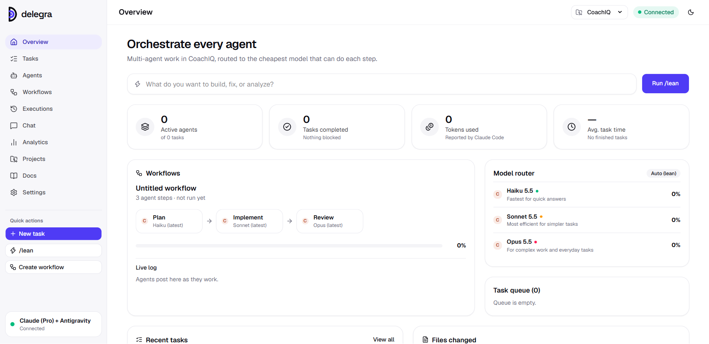
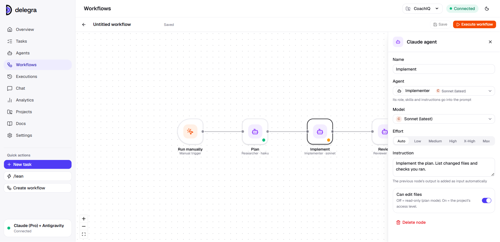
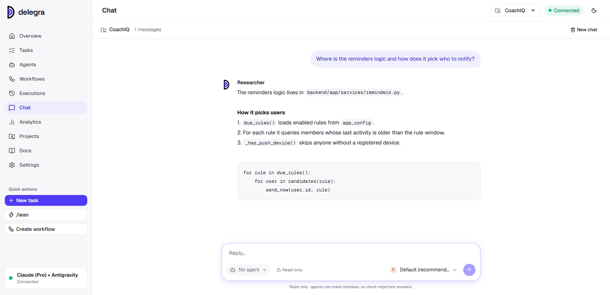
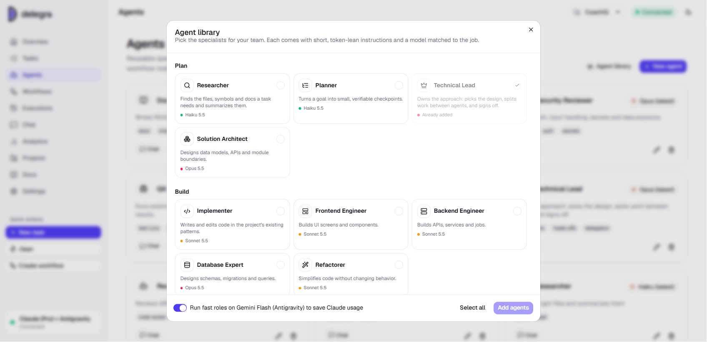

<div align="center">

<picture>
  <source media="(prefers-color-scheme: dark)" srcset=".github/assets/delegra-mark-dark.svg">
  
</picture>

<h1>delegra</h1>

<p><b>Orchestrate every agent.</b><br>
Run Claude Code and Antigravity agents across any project on your computer,<br>
on the AI plans you already have. No API keys.</p>

<p>
  
  
  
  
  
</p>

<p>
  <a href="#-quick-start"><b>Quick start</b></a> ·
  <a href="#-features"><b>Features</b></a> ·
  <a href="#-how-connecting-works"><b>Connecting</b></a> ·
  <a href="#-models"><b>Models</b></a> ·
  <a href="#-architecture"><b>Architecture</b></a> ·
  <a href="#-roadmap"><b>Roadmap</b></a>
</p>

<br>



</div>

<br>

## ✦ Why Delegra

Most coding work does not need your most expensive model. Delegra lets you split work into steps and give each step to the **cheapest agent that can do it well**: Haiku or Gemini Flash to research, Sonnet to build, Opus to review. You can watch it all happen live.

<table>
  <tr>
    <td width="33%" valign="top">
      <h3>🔌 Your plans, your machine</h3>
      Agents run through the Claude Code and Antigravity CLIs signed in on your computer. No API keys, no proxy, no credentials stored.
    </td>
    <td width="33%" valign="top">
      <h3>🪙 Token-lean by design</h3>
      Route each step to the right model and effort level, keep agent rules short, and pass only the previous step's output forward.
    </td>
    <td width="33%" valign="top">
      <h3>🧭 Built for any project</h3>
      Connect any folder, choose what agents may do there, and switch between projects from the top bar.
    </td>
  </tr>
</table>

<br>

## ✦ Features

<table>
  <tr>
    <td width="50%" valign="top">
      
      <h3>Workflow editor</h3>
      An n8n-style canvas with <b>Trigger</b>, <b>Claude agent</b>, <b>If</b>, <b>Merge</b> and <b>Sticky note</b> nodes. Each agent node has its own model, effort level and file access. Click <b>Execute workflow</b> and watch every node light up.
    </td>
    <td width="50%" valign="top">
      
      <h3>Chat</h3>
      A read-only chat about your project, with agent and model pickers in the composer. Start with <code>/lean</code> to get a staged, cheap plan before anything changes.
    </td>
  </tr>
  <tr>
    <td width="50%" valign="top">
      
      <h3>Agent library</h3>
      18 ready-made specialists: Technical Lead, Architect, Test Engineer, QA, Security Reviewer, Debugger, DevOps and more. Each has short instructions and a model matched to the job. Fast roles can move to Gemini Flash in one switch.
    </td>
    <td width="50%" valign="top">
      <h3>Everything else</h3>
      <ul>
        <li><b>Tasks:</b> one agent per task, with live activity, changed files, tokens, duration, and Run / Stop / Re-run.</li>
        <li><b>Executions:</b> every workflow run, with each node's output.</li>
        <li><b>Analytics:</b> token use by model, success rate and 7-day activity.</li>
        <li><b>Rules:</b> guardrails added to every prompt so agents stay in their lane and don't guess.</li>
        <li><b>Docs:</b> a complete step-by-step guide inside the app.</li>
        <li><b>Light and dark themes</b>, with the Delegra palette.</li>
      </ul>
    </td>
  </tr>
</table>

<br>

## ✦ Quick start

> [!NOTE]
> You need **Node.js 20+** and **Claude Code** signed in to your Claude plan. **Antigravity** is optional; if it isn't installed, its options stay hidden.

```bash
# 1. Install Claude Code and sign in once
npm install -g @anthropic-ai/claude-code
claude auth login

# 2. Get Delegra and start it
git clone https://github.com/Sujay-Dynamisch/Delegra.git
cd Delegra
npm install
npm run dev
```

Open **http://127.0.0.1:3210**, then:

1. **Connect AI** (top right) → allow Claude Code (and Antigravity, if it is installed).
2. **Projects** → **Connect project** → paste a folder path. Start with *Read only*.
3. **Agents** → **Agent library** → add a few specialists.
4. **Tasks** → **New task** → **Create and run**, and watch it work.

<br>

## ✦ How connecting works

```text
 Delegra (localhost:3210)
   │  starts a process per step, sends the prompt on stdin
   ├──► claude -p  ── your Claude Code login ──► your Claude plan
   └──► agy        ── your Antigravity login ──► your Antigravity models
```

| Step | What happens |
| :-- | :-- |
| **Installed** | Delegra checks for `claude` (required) and `agy` (optional). |
| **Signed in** | *Sign in with Claude* runs `claude auth login`, which opens Anthropic's own page. Antigravity uses its own app sign-in. |
| **Allowed** | A consent screen lists what Delegra will do. **Allow** stores that grant locally, and you can revoke it in Settings. |

> [!IMPORTANT]
> Delegra never reads, copies or stores your credentials. `ANTHROPIC_API_KEY` and `ANTHROPIC_AUTH_TOKEN` are removed from every agent process, so a run never switches to API billing by accident.

<br>

## ✦ Models

| Model | Provider | Best for | Tier |
| :-- | :-- | :-- | :-: |
| **Default (recommended)** | Claude Code | Your plan's recommended model | 🟠 |
| **Opus 5.5** | Claude Code | Complex work, architecture, final reviews | 🔴 |
| **Sonnet 5.5** | Claude Code | Features, fixes and reviews | 🟠 |
| **Fable 5.2** | Claude Code | The toughest problems | 🔴 |
| **Haiku 5.5** | Claude Code | Fast research, checks and small edits | 🟢 |
| **Gemini, GPT-OSS and more** | Antigravity | Whatever your account offers; Flash is cheapest | 🟢 – 🔴 |

**Effort** (`Auto` · `Low` · `Medium` · `High` · `X-High` · `Max`) can be set on an agent, a task or a workflow node, and is passed to the CLI as `--effort`.

<br>

## ✦ Access levels

| Level | Agents can | Use it for |
| :-- | :-- | :-- |
| 🔒 **Read only** | Read and plan; no edits or commands | First runs, reviews, questions |
| ✏️ **Edit files** | Edit files; other tools follow your Claude Code settings | Everyday work |
| ⚡ **Full access** | Run any tool without asking | Sandboxes only |

<br>

## ✦ Architecture

<details>
<summary><b>Project layout</b></summary>

```text
src/
├─ app/
│  ├─ api/            REST + live events (projects, tasks, run, chat, providers, models, library)
│  ├─ workflows/[id]/ n8n-style editor (React Flow)
│  ├─ chat/ tasks/ agents/ runs/ analytics/ projects/ settings/ docs/
│  └─ layout.tsx      theme, fonts, shell
├─ components/
│  ├─ app/            shell, pickers, connect dialog, brand
│  ├─ flow/           workflow node types
│  └─ ui/             shadcn/ui (Base UI)
├─ lib/               types, client hooks, agent templates
└─ server/
   ├─ claude.ts       Claude Code runner (stream-json)
   ├─ agy.ts          Antigravity runner (NDJSON over stdin)
   ├─ providers.ts    model catalogue + routing
   ├─ engine.ts       task runner + graph executor
   └─ store.ts        JSON store with live change events
```

</details>

<details>
<summary><b>Security model</b></summary>

- The server listens on **127.0.0.1 only** and rejects requests from other origins (CSRF and DNS-rebinding protection).
- Prompts reach the CLIs through **stdin**, never through a shell command line.
- Agents work only inside connected folders, at that project's access level.
- All data (projects, agents, tasks, workflows, runs, rules and grants) lives as JSON in `./data`, which is git-ignored.

</details>

<details>
<summary><b>Stack</b></summary>

Next.js 16 (App Router) · TypeScript · Tailwind CSS 4 · shadcn/ui on Base UI · React Flow (`@xyflow/react`) · lucide icons · Geist and Space Grotesk.

</details>

<br>

## ✦ Roadmap

- [ ] **Hosted dashboard + local runner:** use Delegra from anywhere while agents still run on your machine
- [ ] Scheduled workflows (cron trigger node)
- [ ] Parallel branches that execute at the same time
- [ ] A git worktree per task, for conflict-free parallel agents
- [ ] Diff viewer for changed files
- [ ] Export and import agents and workflows

<br>

<div align="center">
  <sub>Built for developers who want more done with fewer tokens.</sub><br>
  <sub><b>delegra</b> · orchestrate every agent</sub>
</div>
